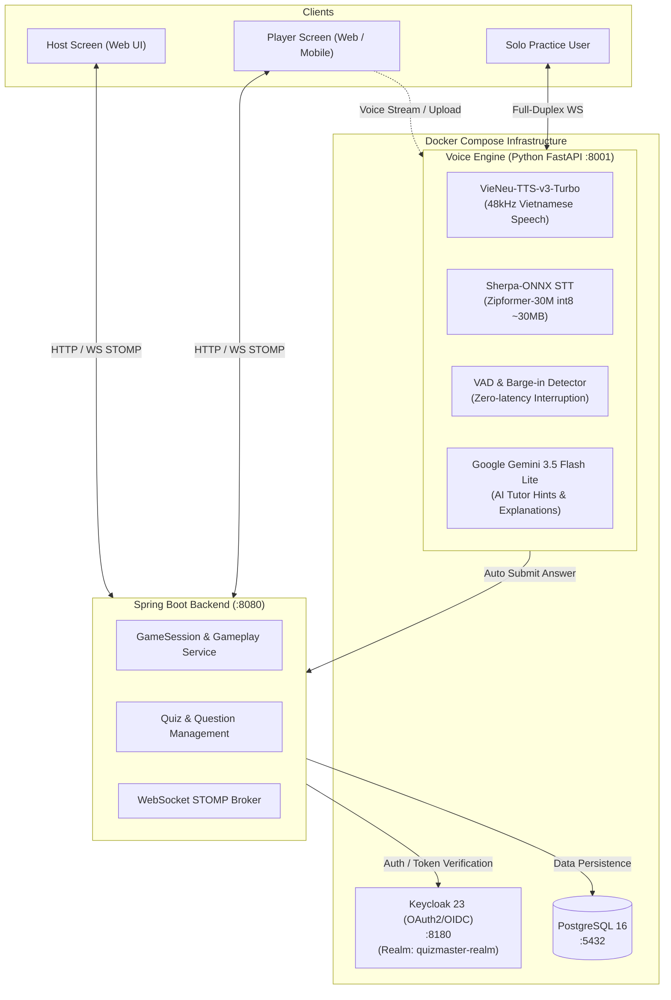

# 🎮 QuizMaster - Real-Time AI Multiplayer Trivia & Voice Platform

> A scalable, event-driven platform for live multiplayer quiz games inspired by Kahoot!, featuring an integrated **AI Voice Engine** for Vietnamese speech synthesis (TTS), speech recognition (STT), and conversational practice with **Google Gemini**.


---

## 🏛 Architecture Overview



---

## ✨ Key Features

### 1. Spring Boot Multiplayer Backend (`be/`)
- 🔐 **OAuth2 / OIDC Security**: Integrated with Keycloak 23 using JWT Bearer tokens and role-based permissions (`ADMIN`, `USER`).
- 🧩 **Quiz Management**: RESTful APIs for creating quizzes, multiple-choice questions, and dynamic options.
- ⚡ **Multiplayer Real-time Gameplay**: WebSocket (STOMP + SockJS) for game sessions, live player joins, question broadcasts, and countdown timers.
- 🏆 **Live Leaderboards**: Automatic scoring calculation based on speed and accuracy.
- 🕹️ **Headless Web Client**: Built-in test pages (`/host.html`, `/player.html`) for instant browser-based gameplay testing.

### 2. AI Voice Service Engine (`voice/`)
Structured with a clean **Layered Architecture** (Controller, Service, Adapter/Integration, DTO, Core Settings):

#### 🎤 Scenario 1: AI MC Virtual Host (TTS)
- **Model**: `pnnbao-ump/VieNeu-TTS-v3-Turbo` running via lightweight CPU ONNX Runtime.
- **Audio Quality**: Studio-grade 48kHz Vietnamese speech with **25 preset regional voices** (Minh Quân, Hải Đăng, Trúc Ly, Mai Anh, v.v.).
- **Capabilities**:
  - Automatically script and synthesize question reading with choices.
  - Generate lively scoreboard commentary and race updates between players.
  - Formats: MP3 / WAV stream or JSON Base64.

#### 🎙️ Scenario 2: Voice-based Trivia Answering (STT)
- **Model**: `csukuangfj2/sherpa-onnx-zipformer-vi-30M-int8` (~30MB model, pure C++ ONNX Runtime on CPU, zero PyTorch dependency).
- **Universal Audio Decoder**: Accepts browser audio in WAV, MP3, WebM, OGG, Opus, AAC, or raw PCM.
- **3-Tier Smart Answer Matcher**:
  1. *Option Labels*: Recognizes "A", "Đáp án B", "Tôi chọn C", "Ý D", "bê", "b bò", "xê", "cờ", "đê".
  2. *Numeric Indices*: Recognizes "Một", "Hai", "Ba", "Bốn", "Thứ nhất", "1", "2", "3", "4".
  3. *Content Fuzzy Match*: Recognizes option text directly (e.g. saying *"Hà Nội"* automatically matches *"Option A: Hà Nội"* with high confidence).
- **Auto-Submission**: Automatically forwards matched answers to Spring Boot's `POST /api/sessions/{sessionId}/submit-answer` and returns points and correctness.

#### 🤖 Scenario 3: 1-on-1 Solo Practice Voicebot (Full-Duplex WS + LLM)
- **Full-Duplex WebSocket** (`/ws/solo-practice`): Simultaneous 2-way audio streaming.
- **VAD & Barge-in Interruption**: Detects player speech in real-time (`-38 dBFS`) and **instantly cancels bot audio playback** when interrupted.
- **AI Tutor powered by Gemini 3.5 Flash Lite**:
  - *Smart Hints*: When the player says *"Gợi ý cho tôi"* or *"Khó quá"*, Gemini provides a clever clue **without spoiling the answer**.
  - *Explanations*: When the player asks *"Tại sao lại chọn đáp án đó?"*, Gemini explains concisely in 1-2 sentences.
  - *Natural Dialogue*: Engages in short, encouraging chit-chat.

---

## 🚀 Quick Start Guide

### Prerequisites
- [Docker & Docker Compose](https://www.docker.com/)
- [Java 17+](https://adoptium.net/) (with `JAVA_HOME` configured)
- [Maven](https://maven.apache.org/) (or use `./mvnw` included in `be/`)
- (Optional) [Google Gemini API Key](https://aistudio.google.com/) for AI Tutor features

---

### Step 1: Environment Configuration

Copy the example environment file and configure your credentials:

```bash
cp .env.example .env
```

Ensure `.env` contains your Gemini API key (optional, for Solo AI Tutor):
```env
GEMINI_API_KEY=your_gemini_api_key_here
GEMINI_MODEL=gemini-3.5-flash-lite
```

---

### Step 2: Start Infrastructure & Voice Engine

Start PostgreSQL, Keycloak, and the Voice Service Engine in Docker:

```bash
docker compose up -d
```

Check container status:
```bash
docker compose ps
```

Verify Keycloak and Voice Engine:
- **Keycloak Console**: `http://localhost:8180` (admin / admin)
  - Pre-configured realm `quizmaster-realm` and client `quizmaster-client` are auto-imported.
  - Default Test User: `testuser@example.com` / `Password123!`
- **Voice Engine Swagger Docs**: `http://localhost:8001/docs`
- **Voice Engine Health Check**: `http://localhost:8001/health`

---

### Step 3: Run Spring Boot Backend

In a separate terminal, start the Spring Boot application:

```bash
cd be
# On Windows PowerShell:
.\mvnw.cmd spring-boot:run

# On Linux / macOS:
./mvnw spring-boot:run
```

The backend starts at:
```
http://localhost:8080
```

- **Spring Boot Swagger UI**: `http://localhost:8080/swagger-ui/index.html`

---

## 🕹 How to Test Gameplay & Voice

### A. Testing Multiplayer Quiz (Web Browser)

1. **Host Dashboard**:
   - Open `http://localhost:8080/host.html`.
   - Obtain a JWT token using `testuser@example.com` / `Password123!` from Keycloak (`POST http://localhost:8180/realms/quizmaster-realm/protocol/openid-connect/token`).
   - Paste Quiz UUID and click **Create Session** $\rightarrow$ Receive 6-digit Game PIN.

2. **Player Screen**:
   - Open `http://localhost:8080/player.html` in another browser window/tab.
   - Enter Game PIN and Nickname $\rightarrow$ Click **Join**.

3. **Gameplay**:
   - Host clicks **Start Game** / **Next Question**.
   - Player selects answers $\rightarrow$ Leaderboard updates in real-time.

---

### B. Testing AI Voice Service APIs

Explore and test directly via Swagger UI at **`http://localhost:8001/docs`**:

#### 1. MC Synthesize Audio (TTS)
```http
POST http://localhost:8001/api/v1/mc/synthesize
Content-Type: application/json

{
  "text": "Chào mừng các bạn đến với QuizMaster! Hãy sẵn sàng cho câu hỏi đầu tiên.",
  "voice": "Minh Quân",
  "as_mp3": true
}
```

#### 2. Transcribe Audio (STT)
```http
POST http://localhost:8001/api/v1/voice/transcribe
Content-Type: multipart/form-data

file: [Select WAV / WebM / MP3 audio file]
```

#### 3. Match Spoken Answer
```http
POST http://localhost:8001/api/v1/voice/answer/match
Content-Type: application/json

{
  "transcribed_text": "Tôi chọn đáp án A, thủ đô Hà Nội",
  "options": [
    {"id": 101, "label": "A", "text": "Hà Nội"},
    {"id": 102, "label": "B", "text": "Đà Nẵng"},
    {"id": 103, "label": "C", "text": "TP Hồ Chí Minh"}
  ]
}
```

#### 4. Solo Practice Bot Interaction (Gemini + TTS)
```http
# 1. Start a session
POST http://localhost:8001/api/v1/solo/start
Content-Type: application/json

{
  "quiz_title": "Luyện Tập Địa Lý",
  "voice": "Minh Quân"
}

# 2. Ask for a hint (Gemini generates witty clue without spoiling)
POST http://localhost:8001/api/v1/solo/{session_id}/interact
Content-Type: application/json

{
  "text": "Gợi ý cho tôi một chút đi bot"
}
```

#### 5. Real-Time WebSockets
- **Live Answer Stream**: `ws://localhost:8001/ws/voice-answer`
- **1-on-1 Practice with Barge-in**: `ws://localhost:8001/ws/solo-practice`

---

## 📂 Repository Structure

```
QuizMaster/
├── be/                          # Spring Boot Backend (Java 17)
│   ├── src/main/java/           # Controllers, Entities, DTOs, Services
│   ├── src/main/resources/      # application.properties & static HTML test client
│   └── pom.xml                  # Maven dependencies
├── voice/                       # Voice AI Engine (Python 3.11 FastAPI)
│   ├── app/
│   │   ├── api/                 # Controllers (MC, Voice Answer, Solo Bot)
│   │   ├── core/                # Settings & Logging configuration
│   │   ├── integrations/        # VieNeu-TTS, Sherpa-ONNX STT, Gemini LLM
│   │   ├── schemas/             # Pydantic DTO models
│   │   ├── services/            # MC Service, Answer Matcher, Solo Practice Service
│   │   └── utils/               # Audio conversion & VAD Barge-in detector
│   ├── models/                  # Downloaded ONNX model weights (gitignored)
│   ├── Dockerfile               # Python voice engine Docker build
│   └── requirements.txt         # Dependencies (fastapi, uvicorn, sherpa-onnx, vieneu)
├── keycloak-import/             # Pre-configured Realm and Client JSON
├── docker-compose.yml           # Multi-container orchestration (DB, Auth, Voice)
├── .env.example                 # Environment template
└── README.md                    # Project documentation
```

---

## 🛡️ License

This project is licensed under the MIT License - see the LICENSE file for details.
